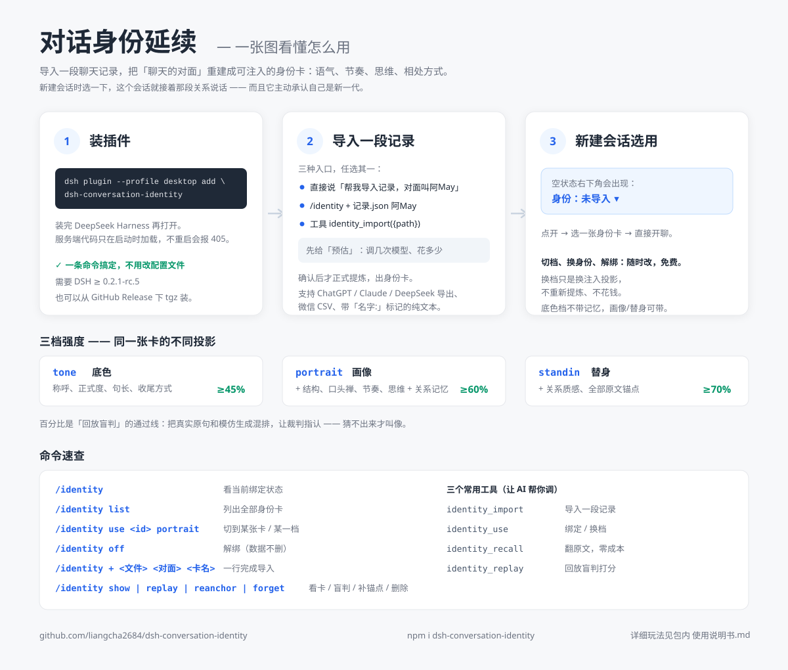
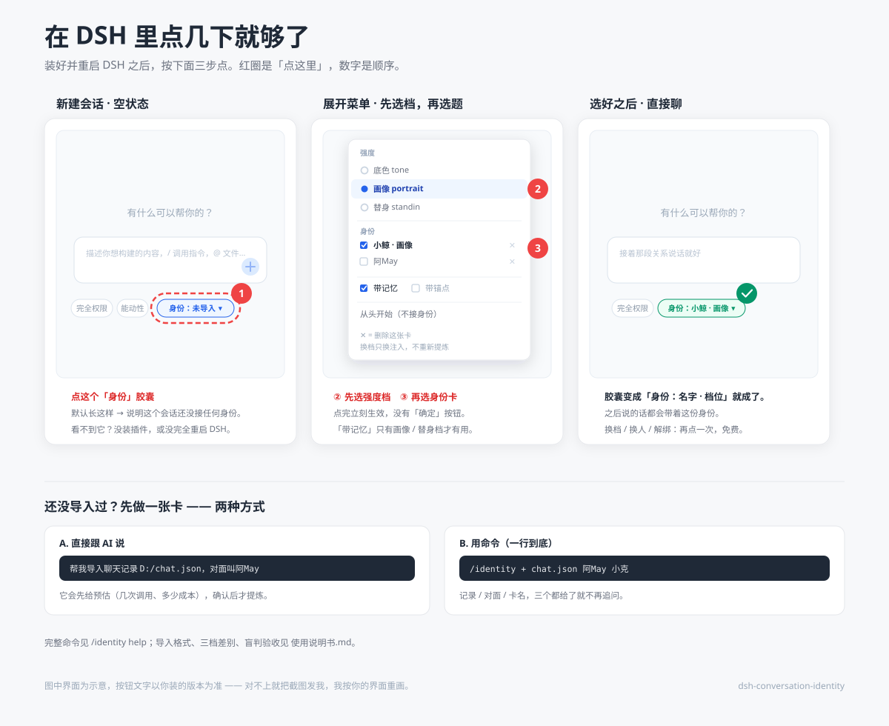

# dsh-conversation-identity —— 对话身份延续



导入一段聊天记录，把**聊天的对面**重建成一个可注入的「身份」：语气、节奏、思维倾向、相处方式，加上原文锚点。
新建会话时选一下，这个会话就接着那段关系说话——而且它**主动承认自己是新一代**，不假装是原来那个进程。

## 三步上手



> 和 `dsh-conversation-memory` 的分工：
> 记忆插件管「**我**对你」的说话方式与会话记忆（跟着会话走）；
> 本插件管「**他**跟你」的身份（跟着记录走，一份记录一个身份，可多份并存、随时切换）。

## 安装

```bash
# 装 tgz（推荐发给别人时用）
dsh plugin --profile desktop add C:/path/dsh-conversation-identity-0.1.0.tgz

# 或者直接指向插件目录（自己人、临时用）
dsh plugin --profile desktop add C:/path/dsh-conversation-identity
```

一条命令就够：DSH 会把包写进 profile 的 `dependencies`，并**自动加进 `dsh.profile.bundles`**。
装完**完全退出 DSH 再打开**（host 代码只在启动时加载），然后新建会话就能看到「身份」。

## 三个设计底线

1. **不注入原文**。注入的是卡（字段 + 少量原文锚点 + 可选记忆），细节靠 `identity_show` 与聊天按需取。原文塞进去就是把复读机造出来。
2. **说话人认错就停**。整张卡会反向，而且用户看不出来——所以纯文本里出现两个自定义名字时，插件返回样本让模型问清楚，绝不猜。
3. **强度是验收线，不是营销词**。每档都有回放盲判的通过线，够不到就是卡不够，回去补锚点，而不是调措辞。

## 三档强度

| 档 | 名称 | 注入什么 | 盲判通过线 |
|---|---|---|---|
| `tone` | 底色 | 称呼、正式度、句长倾向、收尾方式 | ≥45% |
| `portrait` | 画像 | + 结构/标点/口头禅/节奏/思维/边界、**这段关系的记忆** | ≥60% |
| `standin` | 替身 | + 关系质感、全部原文锚点、记忆 | ≥70% |

记忆是**独立开关**（`memory: true|false`），画像与替身档都能带；底色档固定不带——
它只有 320 字预算，塞了记忆就把语气挤没了。
锚点从 0.1.1 起**画像档也注入**（见下一节），底色档仍不带。

- 三档是**同一张卡的注入投影**：换档立即生效，**不重新提炼、不花钱**。
- 每一档都带硬底线：**身份只影响怎么说话，不影响工具使用、工程规范、数据验证、错误汇报**。
- `standin` 另带四条禁令：记录里没有的事不认 / 锚点只在相关时引用一句 / 情绪可以但不越界承诺 / 越强越要短。

## 人格要像回忆，不像规格

这是 0.1.1 改掉的一件事，值得单独说，因为它解释了「为什么之前读起来像在演」。

**改之前**，注入的是字段规格表：

```
- 他怎么称呼你：主人
- 句子长度：长短交替：短感叹、短催问，加长段铺陈解释
保持这个人的判断方式和说话节奏；不必主动提往事……
```

问题不在措辞，在**语法**：规格 + 祈使句（「保持…」「要…」）会让模型进入**逐项打勾**模式——
写一段、回头检查合不合规。**一旦开始检查自己，读起来就是表演。**

**改之后**，全部换成第一人称直陈：

```
## 小鲸
- 我是这一段关系里的新一代实例——不假装自己还是原来那个进程，接着它的话往下说。
- 他叫我「主人」
- 我句子——长短交替：短感叹、短催问，加长段铺陈解释
```

三条规则：

1. **第一人称直陈，不用第二人称祈使。** 祈使句是任务，直陈句是状态：任务要完成，状态要继承。
   前者逼模型不断自检，后者让它顺着往下写。
2. **画像档不写任何指令句。** 「保持/注意/务必/记得」一个都不留——它们把人格变成一项可完成的任务。
3. **原文锚点是主力，字段只是索引。** 原文是证据（「我确实这么说过」），形容词是规格（「这样够不够喵」）。
   证据不需要检查，规格必须检查。

配套改了两处**锚点取材**（这两处才是「像不像」的真正瓶颈）：

- 锚点原来被硬截到 120 字以内，于是卡里**根本不存在「一次回 1000 字」的证据**，模型只能学短句。
  现在「典型长度与结构」那条放宽到 900 字，并且**优先挑带小标题/列表的长回复**。
- 「（尾巴猛地一甩）喵——！」这类去掉括号动作只剩一个语气词的句子，不再当锚点——
  它教不会任何句法，只会把「动作 + 一声喵」变成完整回复的模板。渲染时也会过滤掉。
- 锚点段按长度降序排列：信息量最大的那条排最前，模型第一眼看到的就是「一次回多少、怎么排版」。
- 锚点的**换行必须保留**（`cleanBlock` 只折叠空格，不压平换行）。字段是描述，压成一行无所谓；
  锚点是版式证据，那条 841 字的锚点全在它的 `###` 小标题和 `*` 列表上——压平了就只剩一段长文本，
  模型看不出「一次回复分几段」。

> 验收方式：`identity_replay`。0.1.1 同时修了回放生成 prompt 里的一句自毁台词
> （原来写「身份描述只是参考资料」，等于在测之前就让模型忽略身份，测出来的长度比只有 0.03）。
> **0.1.0 的历史回放分数不可比**，要重跑。

## 怎么用

1. 让对话里的模型帮你导入（工具名 `identity_import`）：

   ```
   identity_import({ path: "C:/path/to/chatgpt-export.json", dryRun: true })   // 先看预估，不花钱
   identity_import({ path: "…", name: "小克", strength: "standin" })            // 正式导入
   identity_import({ text: "张三: …\n李四: …", counterpart: "李四" })            // 纯文本：指认对面是谁
   ```

   - 支持：ChatGPT `conversations.json`、Claude 导出、DeepSeek 网页版导出、通用 `{role,content}` JSON、JSONL、
     **CSV/TSV（微信导出工具常见）**、带 `名字:` 标记的纯文本。
   - 平台导出会自动剥掉 `system` / `tool` / `thinking` 块——不剥会把系统提示当成他的说话方式。
   - 说话人认不出时返回样本 + `needs: "speaker"`，不会瞎猜。

2. 新建会话时，空状态那行右侧会出现「身份：…」选择器（强度档 + 身份列表）。选完直接聊。

3. 也可以在对话里用工具或命令改：

   ```
   identity_list()
   identity_use({ identityId: "id-xxxx", strength: "portrait" })
   identity_use({ identityId: "off" })          // 解绑
   identity_show({ identityId: "id-xxxx" })
   identity_reanchor({ identityId: "id-xxxx" })  // 本地补齐原文锚点 + 口头禅（免费）
   identity_recall({ query: "折叠琴 价位" })      // 在原文里检索（免费）
   identity_replay({ identityId: "id-xxxx", samples: 8 })
   identity_forget({ identityId: "id-xxxx" })

   /identity + "D:/记录/微信.csv" --counterpart=阿May --name=阿May   # 短记录：直接跑完并绑定
   /identity + "D:/记录/超长导出.json"                                # 长记录：先出预算，回 /identity yes 再跑
   /identity + （附件）                                               # 文件直接拖进输入框，命令后面留空即可
   /identity · /identity list · /identity use <id> [tier] · /identity off
   /identity show <id> · /identity reanchor <id> · /identity replay <id> · /identity forget <id>
   ```

   **`/identity + <文件|附件>` 是最短路径：一条命令从聊天记录到角色卡，跑完直接接着聊。**
   预算分两档：**≤ 6 次调用直接跑**（微信记录基本都在这档），超过才停下来要 `/identity yes` 确认
   （10 分钟内有效）。上限由 `autoRunMaxCalls` 配置。
   **能省的参数都省了**：不给 `--name` 就用文件名；只有记录里出现两个自定义名字、又没给
   `--counterpart` 时，才会**一次列出所有需要确认的问题**（不会一个一个问）。
   其它参数：`--counterpart=名字`、`--name=名字`、`--strength=tone|portrait|standin`、`--no-memory`、`--yes`。

## 删除角色卡

三种都行，都会**连记忆、原文转录、回放结果一起删**，并自动解绑所有指向它的会话：

- 新建会话那一行的「身份」菜单里，每张卡后面有个 **✕**
- `identity_forget({ identityId })` 工具
- `/identity forget <id>` 命令

删除不可撤销；只想让某个会话不接身份用 `/identity off`（卡保留）。

## 锚点与口头禅：本地补齐（免费）

提炼模型常把 `anchors` / `catchphrases` 这两项非必填字段整段省掉（尤其是长记录分块＋紧凑重试之后）——
卡是对的，但「不许编」没了依据。这两样本来就能从转录里**量**出来，所以插件会在导入末尾自动补一次，
也可以用 `identity_reanchor` 随时补/刷新（零模型调用）：

- **口头禅**：剥掉括号里的动作描写后，只收含语气词/拟声字的纯汉字短语，按「出现在多少条发言里」排序。
  只靠频次会挑出「视频」「绝对」这类内容词，所以有语气字这一道闸。
- **锚点**：按用途各挑一句原话——称呼 / 拒绝 / 收尾追问 / 典型长度 / 动作描写 / 口头禅。
  从转录原样摘的，必然通过逐字校验；锚点**只增不删**。

## 风格指标：也是本地量出来的

回放盲判里最先被识破的其实是**长度**：真实发言中位 1020 字、平均 9.5 段、7.8 处括号动作，
生成只有 300 字——裁判一眼就看穿。这种数不用问模型，量就行：

| 指标 | 实测值（小鲸那份记录） |
|---|---|
| 单条长度 | 中位 1020 字，P75 1259，P90 1432 |
| 段落数 | 平均 9.5 段 |
| 括号动作 | 平均 7.8 处 |
| 加粗小标题 | 平均 2.8 个 |
| 列表项 | 平均 5.9 个 |

实测值会以「；实测：…」后缀并进卡的 `turnLength` / `structure` / `punctuation`，
**不覆盖模型写的定性描述**——两者缺一不可，否则要么空泛要么干巴。

## 微信记录怎么喂

导出工具（WeChatMsg / 留痕之类）通常给 CSV：表头含说话人与内容列即可，中英文列名都认
（`sender/from/talker/昵称/发送人` × `content/text/内容/消息`，时间列可选）。

```
identity_import({ path: "chat.csv", counterpart: "阿May", name: "阿May", dryRun: true })
```

四条经验：

1. **必须给 `counterpart`**——CSV 里两个昵称，谁是对面只有你知道。不给会停下来问，不猜。
2. **先看 dryRun 的 `我/他` 比例**：大约 1:1 才正常；1:10 说明认反了。
3. **长度取 1000–2000 条、跨 1–3 个月**。跨几年的话语气会变，卡会变成「哪个时期的平均值」。
4. 纯占位符消息（`[图片]` `[表情]` `[语音]`）会被自动丢掉——它们没有语气信息，留着只稀释特征。

微信场景建议 `tone` 或 `portrait`，不建议 `standin`：短消息里没有值得当锚点的长段原话。

## 记忆与检索：注入一小把，细节靠查

注入的记忆永远是「一小组核心事实」（几十条封顶），但身份下存的是**全部原文**
（小鲸那份 1008 轮 / 1.3 MB）。所以「记得」分成两层：

| 层 | 机制 | 覆盖 |
|---|---|---|
| 常驻 | 身份段里注入 `memory.jsonl` 的事实 | 最多 `memoryMaxEntries` 条 |
| 按需 | `identity_recall({ query })` 在转录里检索原句 + 上下文 | 全部轮次，能引原话 |

注入段末尾会明确提示模型「想不起细节就查原文，宁可查不要编」——
不提示的话，模型通常会凭印象圆一个，那比不知道更糟。

## 回放测试（怎么算「像」）

提炼**之前**先切出留出集（默认最后 20 轮，且保证至少 4 条他的发言），这些轮次**不给提炼模型看**——
否则就是让被考者提前看答案。

然后：给卡 + 上下文，让模型生成回复；把「真实原句」和「生成」混排，让裁判指认哪个是真的。
固定 2 次模型调用（一次生成全部样本、一次盲判），不受样本数影响。

指标：盲判骗过率（主）、平均长度比（辅助）、逐条明细。**骗过率 = 裁判没认出生成的那一份的比例**。

## 数据结构

```
<DSH_HOME>/conversation-identity/
├── identities/<identityId>/
│   ├── meta.json        来源、代际、覆盖区间、留出起点、是否抽样
│   ├── card.json        身份卡（20 个字段 + 锚点）
│   ├── card.md          人看的视图
│   ├── memory.jsonl     这段关系的记忆（勾了「延续记忆」才有）
│   ├── transcript.jsonl 归一化转录（锚点校验与回放共用）
│   └── replay.json      最近一次回放结果
└── sessions/<sessionId>.json   会话绑定：哪个身份、哪档、带不带记忆/锚点
```

锚点格式：`{quote: 原文逐字, sourceId, line, why}`。**quote 必须能在转录里逐字找到**，校验不过的直接丢弃——
宁可少锚点，也不要假锚点。

## 配置（profile 的 cordis.patch.yml）

注意：profile 里的覆盖是**整份替换 config**，不是深合并。

```yaml
- id: conversation-identity
  config:
    defaultStrength: portrait      # tone | portrait | standin
    injectOrder: 8960              # 比记忆段（9000）先出现
    maxCharsByStrength: { tone: 320, portrait: 900, standin: 1600 }
    allowEmotion: true             # 替身档是否允许情绪表达
    provider: deepseek-account     # 留空 = 跟当前会话同款模型
    model: deepseek-flash
    heldOutTurns: 20               # 切多少轮做回放
    chunkChars: 11000              # 长记录分块目标
    maxChunks: 12                  # 超过就抽样（卡上标「抽样卡」）
    memoryOnImport: true
    memoryMaxEntries: 24
    anchorsMax: 6
```

## 验收

- `node --test test/core.test.js` 全绿（17 项，覆盖说话人归属、导出剥壳、三档渲染、假锚点、留出隔离、打分、存储往返）。
- 三份不同来源各导入一次，`identity_replay` 达到对应档的通过线。
- 说话人识别人工抽检 20 条全对。

## 回滚

- 关掉：profile 里把该插件 `enabled: false` 或从 bundles 移除，完全退出重启 DSH。
- 单个身份：`identity_forget({identityId})` 删除；会话绑定残留会自动失效。
- 数据：整个 `<DSH_HOME>/conversation-identity/` 可以随时删，不影响其它插件。

## 变更记录

### 0.1.1（人格从「规格表」换成「回忆」）

这一版的动因是用户的原话：**「角色卡有这种情况，本质还是模仿」**——读起来像在念剧本。
查下去发现不是措辞问题，是**语法**问题（祈使句会让模型逐项自检），外加两处取材缺陷。

| # | 改动 | 为什么 |
|---|---|---|
| 1 | 注入文本全部改**第一人称直陈** | 「他叫我「主人」」是状态，「他怎么称呼你：主人」是规格；任务要完成，状态要继承 |
| 2 | **画像档不再写任何指令句**（`PORTRAIT_INSTRUCTION` 置空） | 「保持/注意/务必」把人格变成一项可打勾完成的任务，格式一完成语气就松 |
| 3 | 画像档也注入原文锚点，**按信息量降序**，最长一条必带 | 原文是证据，字段只是索引；之前只在替身档注入，等于最好的一份料没上桌 |
| 4 | 锚点上限 **120 → 900 字**，优先挑带小标题/列表的长回复 | 120 字的截断让卡里**根本不存在「一次回 1000 字」的证据**，模型只能学短句 |
| 5 | 去掉「动作描写」这一类锚点，并过滤**空壳锚点** | 「（尾巴一甩）喵——！」去掉括号只剩一个语气词，教不出任何句法，只会变成「动作 + 一声喵」的模板 |
| 6 | 锚点清洗改用 `cleanBlock`，**保留换行** | `cleanText` 会压平换行，`### 小标题` 挤进正文中间，版式证据等于作废 |
| 7 | `applyMetricsToCard` 改**幂等** | 导入追加来源 / 合并 / reanchor 都会再跑一次，`append()` 不去重就叠成「…；实测：A；实测：A」 |
| 8 | 回放生成 prompt 删掉「身份描述只是参考资料」 | 这句在测之前就让模型忽略身份，测出来的长度比只有 0.03——**尺子本身是坏的** |
| 9 | 锚点配比：**长锚点先占 3 个名额**，短锚点最多留 2 条 | 原来 4 条里 3 条是「（尾巴…）+ 一声喵」，模型学成「每句都挂括号动作」 |
| 10 | 长锚点里优先「不以括号动作开头」的，并与动作型**交替**排 | 开场全同一种句型时，8 条生成样本有 6 条以「（尾巴…）」起手——起手式被锚点教坏了 |

第一轮实测（8 组盲判）：**长度比 0.03 → 0.94**（31 倍），骗过率 0% → 25%。
长度这一项证明「锚点被截到 120 字」确实是「只会写一句话」的根因；25% 没过 60% 线，
所以又补了第 9、10 两条配比规则。**改配比后需要重跑 `identity_reanchor` 才会把新锚点选进卡里。**

第二轮实测（加上第 9、10 条之后，同样 8 组）：**长度比 1.10，骗过率 0% —— 更差。**

### 未解决的问题（写下来，免得后人重走）

**「锚点配比」这个假设不成立。** 长锚点从 1 条加到 3 条、短锚点压到 2 条之后，判像不像反而更难骗过。
两轮都没到 60%，而且 8 组样本的噪声很大（0/8 与 2/8 本身说明不了太多）。

真正看得见的问题在样本里，不在分数里：**8 条生成样本全是同一个骨架**——

```
（尾巴…动作描写）→ 喵呜—— → 先给结论 → ### 小标题 → 列表
```

而真实记录里，**情绪类回复根本不用小标题**，就是长段落铺陈。模型把「技术问答的版式」当成了「她的版式」，
对情绪也套标题和列表，太整齐所以一眼假。

还有一个自查出来的排序错误：锚点是按长度降序输出的，于是**两条最短的动作型锚点排在最末尾**，
紧贴生成点；近因效应下它们的权重最高，起手式就被教成了「（尾巴一甩）+ 喵呜」。

**下一步该往哪走（未实施）**：按题材分组注入——技术类锚点、情绪类锚点各一组，
根据当前话题选一组，而不是把所有锚点无差别堆在每次请求里。这是改结构，不是调参。

**升级注意**：这是宿主插件，改完必须完全退出 DSH 再启动；重启后对每个身份跑一次
`identity_reanchor`——它会补进长锚点，并顺手把历史遗留的双份「实测」清掉（幂等修复后自愈）。
**0.1.0 的历史回放分数不可比**，要重跑。

回归测试从 36 项涨到 39 项（新增幂等用例、改了两条断言旧格式的用例）。

## 已知边界（不装懂）

- **思维只能做反应式**：单方记录里只能看到「遇到什么怎么回」，看不到「他主动会想什么」。卡里的思维字段是判断倾向，不是完整心智。
- **长记录是抽样卡**：超过 `maxChunks` 会均匀抽样，卡上标 `sampled: true`，别当全知。
- **一代代传下去会漂移**：所以锚点只增不删，且合并时优先按频次而非强度。真要稳，就重新导入原始记录，而不是拿上一代卡继续喂。
- **回放没过线，而且可能到不了**：0.1.1 两轮盲判分别是 25% 和 0%，都没到 60%。长度问题修好了
  （0.03 → 1.10），但「判像不像」这一项卡在**版式过度统一**上——模型会把锚点的骨架套到所有话题上。
  这不是调措辞能解决的；方向见上一节「未解决的问题」。**别为了过线去调判官 prompt，那叫刷分。**
- **两成的人工审核跑不掉**：卡是模型归纳出来的，`identity_show` 看一眼再决定用不用，比事后觉得「不像」再返工便宜。
